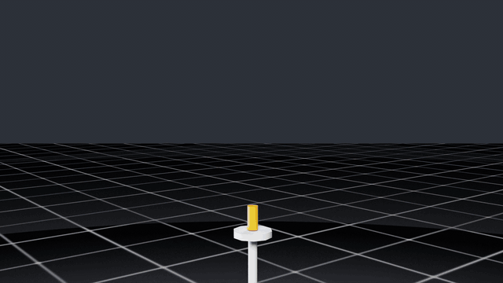
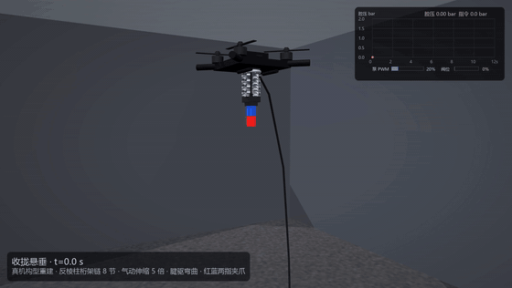
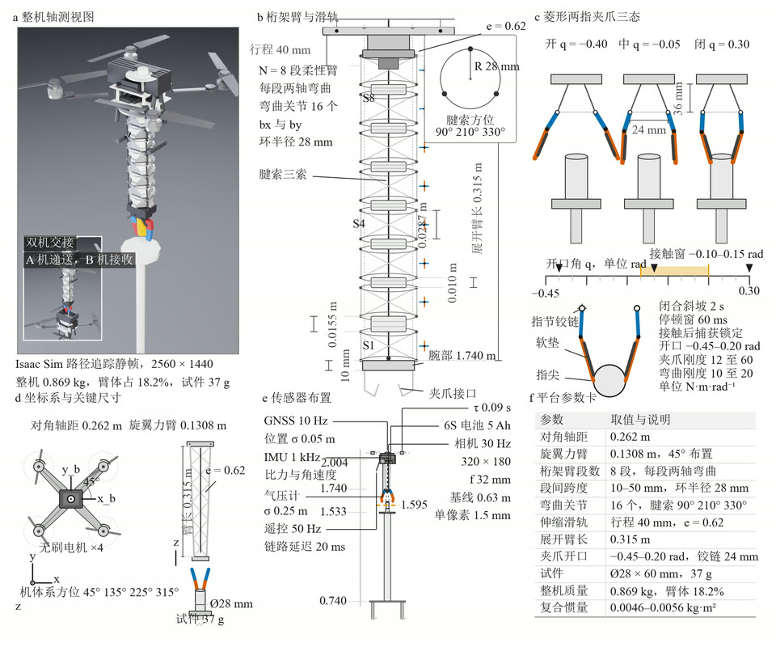
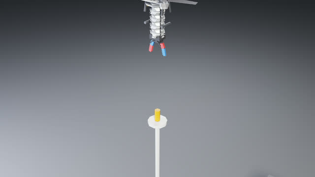
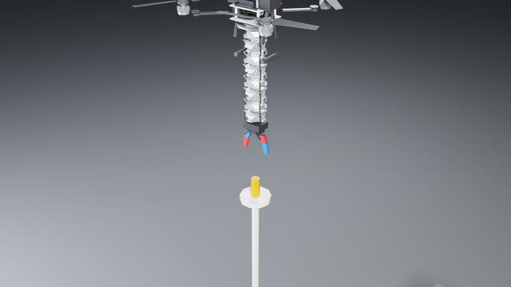
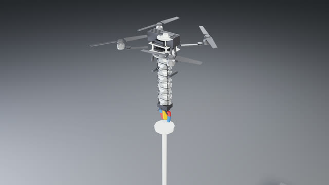
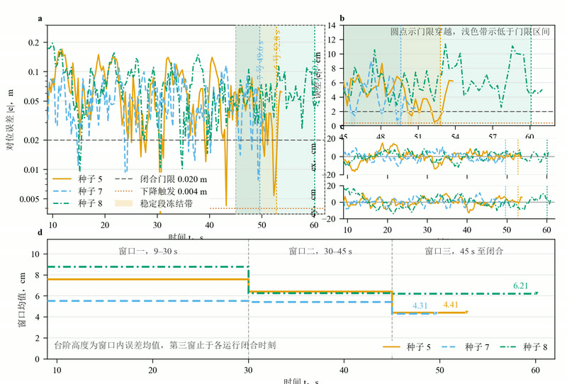

# AerialSoftArm

**Sim-to-real aerial manipulation in Isaac Lab — a truss soft arm that aligns by bending, captures by grip, and hands off between drones.**


<p align="center">
  
  &nbsp;
  
</p>
<p align="center"><em>Left: full autonomous grasp in Isaac Lab. Right: the truss soft arm on hardware.</em></p>

An X-quadrotor carries an **8-DOF truss soft arm** (bend bx/by + telescoping slide + three-tendon coupling) with a wrist camera and a two-finger gripper. The base does coarse positioning and then **freezes**; a **bend-Jacobian visual servo** drives the soft arm to millimetre alignment, and the part is captured only after **both fingers sustain contact for 0.3 s** — a real mechanical grasp, then lift, then dual-drone handover.

---

## ✨ Highlights

- **Bend-dominant alignment** — base frozen after coarse positioning; soft-arm bending is the primary actuator, servoed on wrist-camera vision (~2 mm measurement accuracy)
- **Honest mechanical capture** — attach requires two-finger sustained contact (0.3 s); no single-contact or gravity cheats
- **3/3 seeds PASS** — final alignment error 6–19 mm, lift 0.41–0.47 m, gate-triggered close, reproducible across seeds
- **15-state error-state EKF** — 73% lower velocity RMS than the complementary baseline, with per-sensor NIS gating
- **Online composite inertia** — arm extension changes body inertia by ~2.5×; recomputed every 0.5 s keeps the attitude loop converged
- **Dual-drone handover** — part transferred to a second drone's tray under relative-pose control
- **Sim2real toolchain** — keyboard operation panel, calibration export, and a MuJoCo twin of the real truss arm

---

## 📋 Overview


*Figure 1: The aerial soft-arm system — quadrotor base, truss soft arm, wrist camera, two-finger gripper, and part stand.*

The platform couples a rigid truss backbone with soft bending segments: **rigid sections carry load, soft segments execute alignment and compliant capture**. After vision locks the part, the base moves to a coarse pose and holds; arm extension, bend alignment, mm-scale fine-tuning, grip, and lift all happen with the base frozen.


---

## 🎬 Gallery

<table>
  <tr>
    <td align="center"><br><sub>Hover over stand</sub></td>
    <td align="center"><br><sub>Extend soft arm</sub></td>
    <td align="center"><br><sub>Bend-align to part</sub></td>
    <td align="center"><br><sub>Capture & lift</sub></td>
  </tr>
  <tr>
    <td align="center"><br><sub>Gripper close-up</sub></td>
    <td align="center"><br><sub>A holds for transfer</sub></td>
    <td align="center" colspan="2"><br><sub>Handover to drone B</sub></td>
  </tr>
</table>

---

## 📊 Results


*Figure 2: Horizontal alignment error over the servo window.*


*Figure 3: Per-seed outcome against the four success criteria.*

| Seed | Final error (m) | Lift (m) | Outcome |
|---:|---:|---:|:---:|
| 5 | 0.006 | 0.465 | ✅ PASS |
| 7 | 0.019 | 0.41–0.47 | ✅ PASS |
| 8 | 0.009 | 0.41–0.47 | ✅ PASS |

Success requires **all four** gates: lift > 0.08 m, ≥ 1 contact, final error < 0.02 m, and attach/hold confirmed.

---

## 📦 Repository layout

| Path | Contents |
|---|---|
| `isaac/` | Isaac Lab experiments — `fc_align.py` grasp pipeline, estimators, flight control, calibration, URDF/USD assets |
| `isaac/embodied/` | Pure-numpy flight controller, Mahony / EKF / fused estimators, vision links |
| `arm_real/` | Hardware-truss-arm model pipeline (meshes → MuJoCo XML) + textures |
| `panel/` | Keyboard operation panel with MuJoCo view and sim2real calibration export |
| `grasp_pipelines/` | Soft-Spiral grasp scripts (manual / scripted / vision) on MuJoCo |
| `arm_demo/` | MuJoCo soft-arm and aerial-grasp demos |
| `docs/` | Paper (`paper_full_en.docx`) and technical report |
| `env/` | Locked `requirements.txt` and Python version |
| `media/` | README demos and figures |

---

## 🚀 Quick start

**Isaac side** — Python 3.11, Isaac Sim 5.1 + Isaac Lab 2.3, RTX GPU (full lockfile in `env/requirements.txt`):

```powershell
$env:OMNI_KIT_ACCEPT_EULA = "YES"
$env:PYTHONIOENCODING = "utf-8"
$py = "<python from env_isaaclab>"

# Main experiment: single-drone align-grasp (~25 min headless, PASS judge line at the end)
& $py isaac\fc_align.py --headless --enable_cameras --out runs/fc_align_v7 `
  --eye 0.38,-0.45,0.18 --seed 5 --kp-vel 2.5 --kp-pos 0.4 --ki-att 0.10 --est-g 0.35

# Four-gripper grasp suite, Jacobian calibration, experiment matrix
& $py isaac\run_grasp.py --gripper diamond --headless --out runs/grasp_diamond
& $py isaac\calib_jac.py --headless
& $py isaac\run_matrix.py
```

**MuJoCo side** — `pip install mujoco pillow numpy pyyaml textual`:

```powershell
python arm_demo\aerial_grasp.py
python grasp_pipelines\spiral_grasp_scripted.py
python -m panel
```

---

## 🧩 Components

| Component | What it does |
|---|---|
| `isaac/fc_align.py` | Full align-grasp state machine: vision localize → bend servo → two-finger capture → lift, with four-gate judging |
| `isaac/embodied/estimator_ekf.py` | 15-state error-state EKF (p, v, q, b_a, b_g) with GNSS / baro / gravity updates |
| `isaac/tendon_model.py` | Three-tendon ↔ joint-space coupling: tension, preload, Coulomb friction, hysteresis |
| `isaac/calib_jac.py` | Zero-gravity step calibration of the bend and CoM Jacobians |
| `arm_real/arm_lattice.py` | Truss-arm MuJoCo model with tendon routing — same kinematics as the Isaac asset |
| `panel/` | Real-time keyboard teleop, tuning, logging, and sim2real calibration export |

---

## 📄 Paper

The manuscript is in `docs/paper/`; the technical report is in `docs/`.
